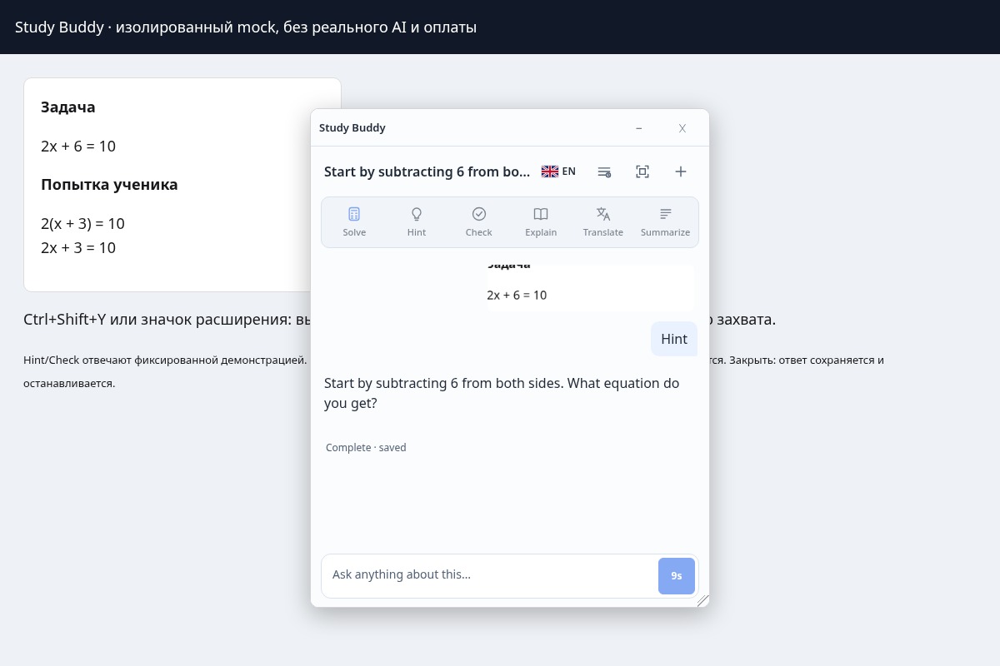

# Study Buddy

A Chromium extension that turns a selected region of a web page into a study conversation. Capture a question, ask for a hint or explanation, and read a streamed answer beside the source material.

**Fullstack TypeScript:** Manifest V3 extension · Node.js HTTP service · SQLite · Server-Sent Events · IndexedDB · Playwright.

[Try the demo](docs/demo.md) · [Architecture and engineering decisions](docs/architecture.md) · [Backend setup and API](src/backend/README.md)



*Real extension and HTTP backend, with a deterministic mock response. This screenshot demonstrates the application flow, not model quality.*

## What it does

- Capture a region with the toolbar icon or `Ctrl+Shift+Y` (`Command+Shift+Y` on macOS).
- Choose Solve, Hint, Check, Explain, Translate or Summarize, or ask a free-form question.
- Read streamed Markdown and LaTeX without leaving the page; select the answer language from the chat toolbar.
- Add more captures to a conversation, open images at full size, and return to the last 20 saved chats.
- Share an active conversation between tabs. Minimize preserves the running answer; Stop and Close cancel it explicitly.

The backend owns provider credentials, request preparation, admission limits and usage accounting. Transcripts and image attachments remain in extension-origin IndexedDB; the server stores operational state rather than chat history.

## Try it without an API key

Prerequisites: **Node.js 22.22.2** (pinned in `.nvmrc`), npm and a Chromium-compatible desktop environment. On Linux, Playwright also needs browser system libraries; see the [demo guide](docs/demo.md).

```sh
npm ci
npx playwright install chromium
npm run preview:local
```

A separate Chromium profile opens a synthetic study page and captures its equation. Click **Hint** to exercise the complete client → backend → mock-provider → client flow. The terminal prints the local demo URL. The backend uses a separate SQLite database for this preview.

For an automated run without a desktop display:

```sh
npm run preview:local -- start --headless --smoke
```

It checks capture, an intermediate streamed answer, completion and restoration after reload without another provider request. Screenshots and a JSON result are saved under `review/preview/run-*/`.

[Demo walkthrough, evidence and test coverage →](docs/demo.md)

## Architecture

```text
Web page
  └─ content overlay: region selection + panel host in a closed shadow root
       │ rectangle + devicePixelRatio
       ▼
MV3 service worker: capture guard → viewport screenshot → OffscreenCanvas crop
       │ capture + conversation coordination
       ▼
Extension chat iframe ──────────────────────── IndexedDB
  │ task + selected context                    transcripts, images, writer state
  │ anonymous session bearer
  ▼
Node.js backend ───────────────────────────── SQLite
  │ validate → prepare request → admit         sessions, operations, budgets
  │ provider request                           no transcript/image persistence
  ▼
OpenRouter
  └─ streamed response → backend SSE → chat rendering + local persistence
```

The chat document owns the network stream. The service worker serializes transcript mutations and coordinates the shared conversation across tabs. The server independently validates the submitted context and reconstructs model instructions.

## Review the frontend and backend

| Area | Engineering problem | Start reading |
| --- | --- | --- |
| Capture and browser lifecycle | Avoid capturing a different tab or a page that navigated during an asynchronous screenshot | [Capture guard](src/background/capture.ts), [service worker](src/background/service-worker.ts) |
| Embedded interface | Isolate page styles, host the extension iframe, minimize and restore it across tabs | [Content overlay](src/content/overlay.ts), [chat](src/chat/chat.ts) |
| Client persistence | Serialize writers, retain partial replies, recover interrupted work and garbage-collect attachments | [Conversation coordinator](src/background/conversations.ts), [IndexedDB store](src/shared/conversation-store.ts) |
| Context and protocol | Keep the saved transcript separate from the bounded context sent to the model | [Context projection](src/shared/conversations.ts), [shared protocol](src/shared/gateway-protocol.ts) |
| HTTP and streaming | Validate requests, manage anonymous sessions, forward deltas and abort disconnected work | [Backend application](src/backend/app.ts), [gateway client](src/shared/gateway.ts) |
| Admission and accounting | Reserve budget atomically, reject duplicate starts and reconcile uncertain provider charges | [SQLite store](src/backend/store.ts), [backend contracts](scripts/backend-contracts.mjs) |

[Tradeoffs, storage model, API and failure handling →](docs/architecture.md)

## Build and connect a real backend

```sh
npm run build
npm run backend:build
```

Load the generated `dist/` directory through **Load unpacked** at `chrome://extensions`. The client defaults to `http://127.0.0.1:8787`. To compile another gateway origin:

```sh
STUDY_BUDDY_GATEWAY_URL=https://api.example.invalid npm run build
```

Copy `.env.backend.example` to `.env.backend`, configure the provider key, session secret and exact extension origin, then start the service:

```sh
node --env-file=.env.backend .backend-dist/server.js
```

The API key is a server runtime variable. The extension has no provider-key form. See [backend setup](src/backend/README.md) for the installation order, environment variables, Docker and service boundaries.

## Verification

[CI](.github/workflows/ci.yml) runs two jobs using the pinned Node version:

- TypeScript checks, client/provider and prompt contracts, context estimation, HTTP/SQLite backend contracts, and both production builds.
- Real Chromium IndexedDB contracts, welcome-page messaging checks, and the capture → streamed answer → reload smoke scenario.

All provider responses in these checks are local fixtures. The [validation guide](docs/demo.md#verification) lists the commands and the older browser suites that currently need maintenance. CI execution on GitHub requires publishing this repository; local results do not imply a hosted CI run.

## Scope and tradeoffs

- Chromium Manifest V3; incognito is disabled. Page access supports the embedded panel, while capture and generation require user actions.
- One backend instance with SQLite. In-memory stream controllers and startup recovery assume a single owner of the operational database.
- Anonymous installation identity supports continuity and limits; it is not an account system or a strong per-person quota.
- Context size is an estimate, not an exact model tokenizer. Older exchanges can be omitted from a request while remaining in local history.
- Public-store copy and privacy text in `store/` are drafts. Deployment notes record earlier operator sessions and are not a live service-status claim.

## Provenance and license

Study Buddy is derived from [OCR Buddy](https://github.com/Fanfulla/OCR-buddy). The viewport-capture guard and the original extension capture workflow come from that project; the Study Buddy tutoring interface, local conversation lifecycle, backend gateway and operational accounting extend that foundation. Local OCR is no longer part of the application flow.

The upstream MIT notice is retained in [LICENSE](LICENSE). Runtime libraries retain their own licenses: [DOMPurify](https://github.com/cure53/DOMPurify), [KaTeX](https://github.com/KaTeX/KaTeX) and [Marked](https://github.com/markedjs/marked).

Product decisions and implementation history remain in [PRODUCT.md](PRODUCT.md), [ToDo.md](ToDo.md) and [BACKLOG.md](BACKLOG.md). They provide historical context; the architecture and setup guides above describe the current source.
